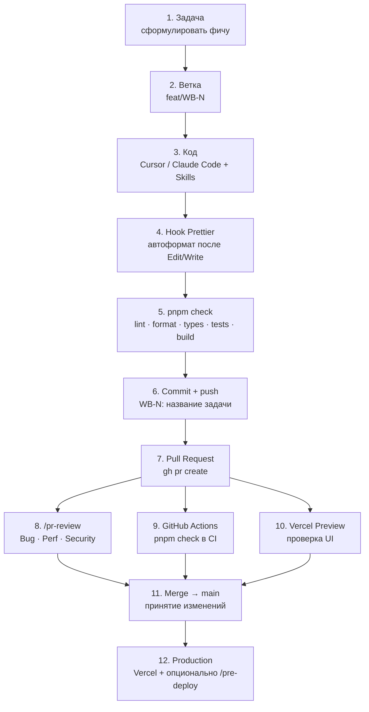

# WorkBot — архитектура пайплайна

Источник правды: `../doc-plank-fde-training/пайплайн.md` (локальная папка). Этот файл — краткий снимок; при расхождении верьте локальному.

## Этапы пайплайна (по порядку)

| №   | Этап               | Что делает                                                                                                                                            |
| --- | ------------------ | ----------------------------------------------------------------------------------------------------------------------------------------------------- |
| 1   | Задача             | Формулируется фича или правка, которую нужно сделать.                                                                                                 |
| 2   | Ветка              | Создаётся ветка `feat/WB-<N>` от актуального `main` (id тикета Linear, напр. `feat/WB-11`).                                                           |
| 3   | Код                | Пишется/меняется код в Cursor или Claude Code; при необходимости вызываются Skills `/component` и `/api-route` для скаффолда.                         |
| 4   | Hook Prettier      | После каждого Edit/Write Claude Code автоматически форматирует изменённый файл через Prettier (`.claude/settings.json`).                              |
| 5   | Локальная проверка | Запускается `pnpm check`: ESLint → Prettier --check → next typegen → tsc → Vitest → next build. Без зелёного check коммит не считается готовым.       |
| 6   | Commit + push      | Subject: `WB-<N>: <название задачи из Linear>`; доп. комментарии в body.                                                                              |
| 7   | Pull Request       | Создаётся PR (`gh pr create`). Открывается обсуждение и гейты.                                                                                        |
| 8   | Ревью `/pr-review` | Параллельно запускаются Bug Hunter, Performance Reviewer и Security Reviewer по diff; собирается общий вердикт (APPROVE / COMMENT / REQUEST CHANGES). |
| 9   | CI GitHub Actions  | Workflow `.github/workflows/check.yml` на PR/push: install с frozen lockfile и тот же `pnpm check` в чистой среде.                                    |
| 10  | Vercel Preview     | На ветку/PR поднимается preview-деплой для ручной проверки UI.                                                                                        |
| 11  | Merge в `main`     | При зелёном CI и приемлемом ревью PR мержится (`gh pr merge --merge`), локально делается `git switch main && git pull`.                               |
| 12  | Production         | Vercel деплоит `main` в production. Опционально перед важной выкладкой — `/pre-deploy` (typecheck, test, поиск `console.log`, сверка env).            |

## Диаграмма

## Детали по контурам

### Локальная разработка (этапы 1–6)

- Skills `/component` и `/api-route` ускоряют создание компонентов и API по соглашениям проекта.
- Hook Prettier не заменяет `pnpm check`: он только форматирует файл сразу после правки.
- `pnpm check` — единый локальный и CI-гейт качества.

### Pull Request (этапы 7–10)

- Три гейта идут **параллельно**: ревью агентами, CI, preview.
- Merge допускается только когда CI зелёный и вердикт ревью приемлемый.

### Выкладка (этапы 11–12)

- Production всегда с `main`.
- `/pre-deploy` — дополнительный чеклист перед ответственной выкладкой, не вместо CI.

## Автоматизация Claude Code

| Тип      | Имя                       | Назначение                           | Где в пайплайне |
| -------- | ------------------------- | ------------------------------------ | --------------- |
| Skill    | `/component`              | React-компонент + Vitest-тест        | Этап 3          |
| Skill    | `/api-route`              | API route + Zod + тесты              | Этап 3          |
| Skill    | `/pre-deploy`             | Гейты перед выкладкой                | Этап 12         |
| Skill    | `/pr-review`              | Параллельное ревью тремя агентами    | Этап 8          |
| Subagent | Bug Hunter                | Логика, null, Promise, race          | Этап 8          |
| Subagent | Performance Reviewer      | await, bundle, лишний `"use client"` | Этап 8          |
| Subagent | Security Reviewer         | injection, auth, секреты             | Этап 8          |
| Hook     | PostToolUse `Edit\|Write` | Prettier на изменённый файл          | Этап 4          |

Конфиг hook: `.claude/settings.json`.  
CI: `.github/workflows/check.yml`.

## Правило обновления

Если меняется любой элемент пайплайна (скрипты `package.json`, workflow, Skills, Subagents, Hooks, ветвление, деплой) — обновите:

1. Этот файл (`docs/pipeline.md`) — **включая нумерацию этапов и описания «что делает»**
2. Раздел «Инструменты Claude Code» в `AGENTS.md`, если затронуты Skills / Subagents / Hook
